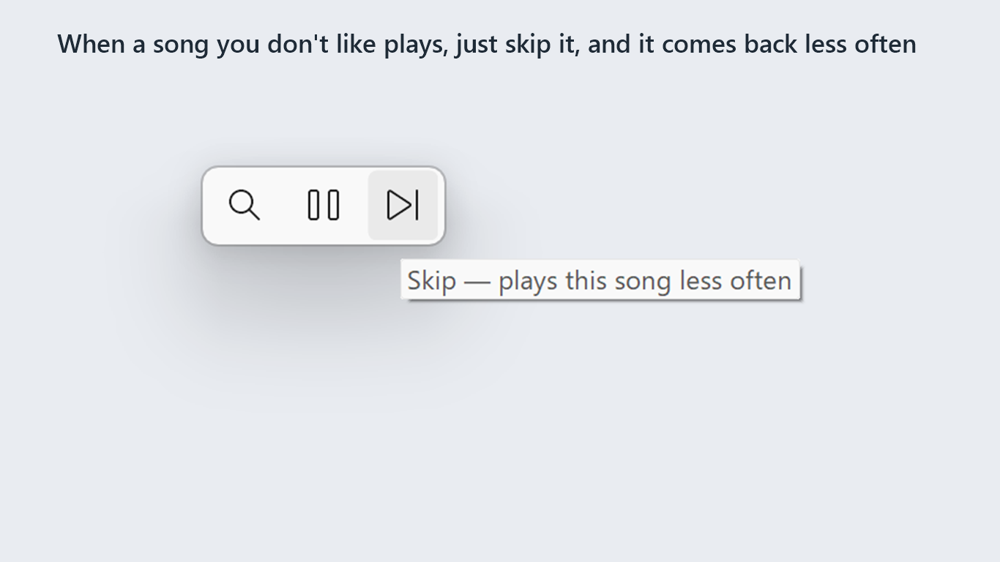

[日本語](index.md)

**A music player that keeps playing your own songs. You just leave it running.**



HamonPlayer is for people who have thousands of their own songs and like to leave music playing while they work on their PC. With shuffle, songs you don't like keep coming back, and to avoid them, you usually have to delete songs, or give songs stars and make playlists. With HamonPlayer, you don't need to do that. It doesn't shuffle, and when you skip a song you don't like, it comes back less often. It has no main window. When another app plays sound, it pauses, and when the other app is quiet again, it plays again.

> **Coming soon. HamonPlayer isn't available yet.** We'll remove this notice when the public beta starts. Until then, the Microsoft Store link and the download page for the setup.exe version below won't open.

## What it does

- **Keeps playing while you leave it alone** — Choose your music folders, and HamonPlayer keeps playing without anything else from you. It has no main window. It only shows an icon in the system tray (near the clock on the taskbar).
- **Songs you skip come back less often** — If you do nothing, every song comes back after about the same number of songs. When you skip a song, it takes longer before it plays again. Nothing is deleted, so if you change your mind, it will play again. If you skip only the songs you don't want to hear, you'll hear more of the songs you like over time. When you like what you hear, select **Like**, and the song comes back sooner.
- **Stays out of the way of other apps** — When another app plays sound, HamonPlayer pauses. When the other app is quiet again, it plays again. You don't need to pause it yourself for a meeting or a video. It doesn't show notification pop-ups either.
- **Search and add to the queue** — Type part of a song name or an artist, and add songs to play after the current one. You can find the songs you just played in History.
- **Start and stop at set times** — With a play schedule, you can set start and stop times for each day of the week.
- **Plays all songs at a similar volume** — You don't need to change the volume for each song.
- **Plays videos too** — Video songs (mp4) play in the same way as music, and show in a small window. You can also show them full screen, or play them behind other windows.
- **Keeps your play data safe** — HamonPlayer backs up the play data for your songs every day. When you change PCs, you can export it to one file and import it on the new PC.
- **English and Japanese** — HamonPlayer follows the Windows display language, and you can also choose the language in Settings.

A phone version (Android) will come after the PC version. It's an app that lets you sync your top songs from your PC to your phone over your home Wi-Fi.

## Requirements

| | |
|---|---|
| OS | Tested on Windows 11 (64-bit, x64) |
| .NET | **Not required.** Everything it needs to run is included |
| Song formats | Plays music in wma, mp3, m4a, aac, and flac, and videos in mp4 |
| Display scale | Tested at 100% and 150% |

For details on the environments we've tested, see [Known issues](known_issues.en.md).

## Get HamonPlayer

### Microsoft Store version (recommended)

Search for "HamonPlayer" in the Microsoft Store and install it. The Store keeps it up to date. **On PCs with Smart App Control turned on, use the Microsoft Store version.**

- Download: <https://apps.microsoft.com/detail/9P297SKZ4T69>

### setup.exe version

**For PCs that can't use the Microsoft Store.** Run `HamonPlayer-<version>-setup.exe` to install it. You don't need administrator rights.

- Download: <https://github.com/poola-vii/HamonPlayer-releases/releases>
- When you recommend HamonPlayer to others, share this page instead of the file. If someone gives you the file, check that it's genuine with "Check the file you downloaded" below before you use it (the rules for sharing are in §4 of the [Terms of Use](terms.en.md)).

**The setup.exe version isn't signed.** Because of this:

- **The first time you run it, Windows shows "Windows protected your PC."** Select **More info**, and then select **Run anyway**.
- On PCs with Smart App Control turned on, you can't use it. Use the Microsoft Store version instead.

**Install only one of the two: the Microsoft Store version or the setup.exe version.**

#### Check the file you downloaded

After you download it, check that it's the same as the one on the distribution site. Run the following in PowerShell, and check that the value matches the table below.

```pwsh
Get-FileHash .\HamonPlayer-1.0.1-setup.exe -Algorithm SHA256
```

| Version | File | SHA-256 |
|:---|:---|:---|
| 1.0.1 | `HamonPlayer-1.0.1-setup.exe` | `86070BF71282584A164F954DFAB7AE6B2913FBFAA93FE070FC90C5AEB467EEE0` |

If the value doesn't match, don't use the file.

## Getting started

1. For the setup.exe version, select **Start HamonPlayer** on the last screen of the setup. Later, and for the Microsoft Store version, start it from **HamonPlayer** in the Start menu.
2. The first setup window opens. **Music folders** starts with your Music folder. If you have songs in other folders, select **Add…**. Subfolders are searched too, so adding the top folder is enough. Put your music folders and video folders in the same list.
3. Usually, leave **Import play data** empty. Use it only when you move from another PC (see "Keep your play data safe" below).
4. Select **OK**. Songs start playing.
5. Left-click the icon in the system tray to get the **Search**, **Pause / Play**, and **Skip** buttons. Right-click it to get all actions, **Settings…**, and **Help**.

**If you can't see the icon:** Windows sometimes puts the icons of new apps in a hidden list. Open the "^" in the system tray to find it. Drag the icon from there to the taskbar to always show it.

**How to use:** Right-click the icon and select **Help** > **How to use**. The page is included in the app, so you can read it without an internet connection.

### Language

HamonPlayer appears in Japanese when the Windows display language is Japanese, and in English otherwise. You can also choose the language with **Language** on the **Advanced** tab in **Settings…**. The change applies after you restart HamonPlayer.

**On Japanese Windows, HamonPlayer appears in Japanese at first, including the first setup window.** To switch to English, right-click the icon and select **設定…** (the third item from the bottom). Open the **詳細** tab (the tab on the right), set **言語** at the top to **English**, and select **OK**. Then right-click the icon, select **終了** (the last item), and start HamonPlayer again.

**HamonPlayer doesn't start automatically when Windows starts, at first.** To start it with Windows, select **Start HamonPlayer when Windows starts** on the **General** tab in **Settings…**.

## Keep your play data safe

Your play data grows each time you listen, and you can't make it again. HamonPlayer backs it up every day.

- **Change the backup folder:** On the **Advanced** tab in **Settings…**, set **Backup folder** to another drive, or to a folder synced by OneDrive or a similar service. Then your play data is safe even if the disk fails.
- **Change PCs:** On the old PC, select **Export play data…** on the **Advanced** tab in **Settings…**, and copy the file to the new PC. Install HamonPlayer on the new PC, and choose that file in **Import play data** during first setup. Only play data moves. Settings and History start again on the new PC.

Your play data and settings are saved in `%LOCALAPPDATA%\HamonPlayer`.

## To stop using HamonPlayer

- **To just stop it:** Right-click the icon and select **Exit**. The next time it starts, it continues where it stopped.
- **To remove the setup.exe version:** In Windows **Settings**, go to **Apps** > **Installed apps**, and uninstall HamonPlayer. **Your play data and settings are kept, and their location is shown.** If you don't need them, delete the `%LOCALAPPDATA%\HamonPlayer` folder (and your backup folder too, if you changed it).
- **To remove the Microsoft Store version:** Uninstall it from **Installed apps** in the same way. **This also deletes your play data and settings** (on a PC where you used the setup.exe version first, they stay). Backups of your play data stay in `HamonPlayer\backups` in your Documents folder, and when you install it again, your play data comes back from them. If you don't need them, delete that folder. To keep everything, export your play data first with **Export play data…**.

## If something goes wrong

- [Known issues](known_issues.en.md) — Known problems and tested environments
- [Support](support.en.md) — How to report problems
- [How to collect logs](log_collection.en.md) — How to get the records we need to look into a problem

## More

- [Changelog](CHANGELOG.en.md)
- [Terms of Use](terms.en.md) (reference translation; the Japanese version is the official one)
- [Privacy Policy](privacy_policy.en.md) (reference translation) — **HamonPlayer doesn't connect to the internet.** Only when you turn on phone sync does it talk to your phone, inside your home network.
- [Third-Party Notices](third_party_notices.en.md)

You can also read the Terms of Use, the Third-Party Notices, and the official download sources in the app: right-click the icon and select **Help** > **Terms and licenses**.

---

© 2026 poola-vii
