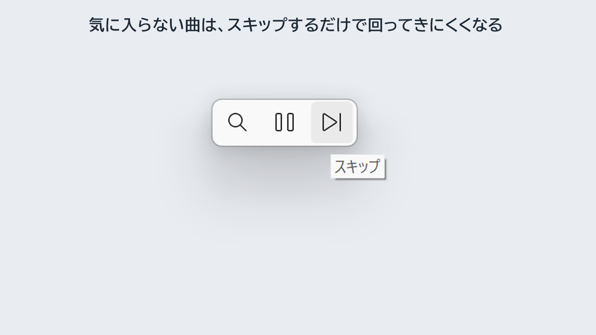

[English](index.en.md)

**持っている曲を、置いておくだけで流し続けるプレイヤーです。**



PC に何千曲も入れていて、作業しながら流しっぱなしにする人のためのプレイヤーです。シャッフルでは気に入らない曲も何度も回ってきて、それを避けるには、曲を消すか、星を付けたりプレイリストを作ったりして整理することになります。HamonPlayer なら、その整理は要りません。シャッフルはせず、気に入らない曲はスキップするだけで回ってきにくくなります。ふだんの画面はなく、ほかのアプリが音を出すと止まり、静かになると戻ります。

> **いまは無料の公開βとして配っています。** 気づいたことがあれば、[問い合わせ窓口](support.md)からお知らせください。分かっている問題は[既知の問題](known_issues.md)にまとめています。

## できること

- **置いておくだけで流れ続ける** — 曲のフォルダを決めれば、あとは何もしなくても流れ続けます。ふだんの画面はなく、通知領域（タスクバーの時計のそば）にアイコンが出るだけです。
- **スキップすると、その曲は回ってきにくくなる** — 何もしなければ、どの曲も同じくらいの曲数のあとにまた回ってきます。スキップした曲は、次に回ってくるまでの間隔があきます。消さないので、気が変わればまた流れます。聴きたくない曲だけスキップしていれば、だんだん好みの曲が多く流れるようになります。「これいいな」と思った曲に「いいね」を押すと、早めに回ってくるようになります。
- **ほかのアプリの邪魔をしない** — ほかのアプリが音を出すと止まり、静かになると戻ります。会議や動画のたびに手で止めなくて済みます。通知の窓も出しません。
- **聴きたい曲は、探して予約** — 曲名やアーティストの一部を打って探し、今の曲のあとに流せます。さっき聴いた曲は履歴から探せます。
- **決めた時刻に流す、止める** — 「再生する時間帯」で、曜日ごとに流し始める時刻と止める時刻を決められます。
- **曲ごとの音の大きさをそろえる** — 曲のたびに音量を触らなくて済みます。
- **動画の曲も流せる** — 音楽と区別なく流します。mp4 の曲は小さな窓に映します。全画面にも、ほかの窓の後ろに敷いて流すこともできます。
- **評価を守る** — 曲ごとの評価（評価データ）は、毎日バックアップします。PC を替えるときは、1 つのファイルに書き出して、新しい PC で取り込めます。
- **日本語と英語** — Windows の表示言語に合わせて出ます。設定で選ぶこともできます。

スマホ版（Android）は、PC 版のあとに出します。PC の評価の高い曲を、家の Wi-Fi でスマホへ持ち出して聴くためのアプリです。

## 動作条件

| | |
|---|---|
| OS | Windows 11（64 ビット、x64）で動作を確かめています |
| .NET | **不要**です。実行に必要なものは同梱しています |
| 曲の形式 | 音楽は wma・mp3・m4a・aac・flac、動画は mp4 を流します |
| 表示倍率 | 100%・150% で動作を確かめています |

確かめた環境の詳しいことは[既知の問題](known_issues.md)にあります。

## 入手する

### Microsoft Store 版（おすすめ）

Microsoft Store で「HamonPlayer」を探して入れてください。更新は Store が行います。**Smart App Control がオンの PC では、Store 版をお使いください。**

- 入手先: <https://apps.microsoft.com/detail/9P297SKZ4T69>

### setup.exe 版

**Store が使えない PC 向けです。** `HamonPlayer-<版>-setup.exe` を実行して入れます。管理者の権限は要りません。

- 入手先: <https://github.com/poola-vii/HamonPlayer-releases/releases>
- ほかの人に紹介するときは、ファイルを渡すのではなく、このページを教えてください。ほかの人から受け取ったファイルは、下の「入手したファイルを確かめる」で本物かどうかを確かめてから使ってください（配り方の決まりは[利用条件](terms.md) §4）。

**setup.exe 版には署名を付けていません。** そのため次のことが起きます。

- **初めて実行するときに「WindowsによってPCが保護されました」という警告が出ます。** 「詳細情報」を押して「実行」を選ぶと進みます。
- Smart App Control がオンの PC では使えません。Store 版をお使いください。

**Store 版と setup.exe 版は、どちらか 1 つを入れてください。**

**setup.exe 版を新しい版にするときは、新しい版の setup.exe を実行します。** アンインストールは要りません。「インストール」を押すと、動いている HamonPlayer は終了して入れ替わります。評価データと設定は引き継がれます。最後の画面の「HamonPlayer を起動する」で起動すると、続きから流れます。

#### 入手したファイルを確かめる

ダウンロードしたら、配布元のものと同じか確かめてください。PowerShell で次を実行し、表示された値が下の表と同じであることを見ます。

```pwsh
Get-FileHash .\HamonPlayer-1.0.6-setup.exe -Algorithm SHA256
```

| 版 | ファイル | SHA-256 |
|:---|:---|:---|
| 1.0.6 | `HamonPlayer-1.0.6-setup.exe` | `B13E9AE54B14B9D6CCC3D48A63316C542DA2007DB187FEB2DD5E78C8B86C77A9` |
| 1.0.2 | `HamonPlayer-1.0.2-setup.exe` | `AC548EF931FF6A26CFA28D73B258DEC960C257FD9E5BD94D9E014228526F2D21` |

値が違うときは使わないでください。

## 最初に使うとき

1. setup.exe 版は、最後の画面の「HamonPlayer を起動する」で起動します。あとから起動するときと Store 版は、スタートメニューの「HamonPlayer」から起動します。
2. はじめての設定の窓が出ます。「曲のフォルダ」には、はじめは「ミュージック」のフォルダが入っています。ほかにあれば「追加…」で足します。中のフォルダも探すので、いちばん上のフォルダだけで足ります。音楽のフォルダも動画のフォルダも、同じ一覧に入れます。
3. 「取り込む評価データ」は、ふつうは空のままにします。前の PC から引き継ぐときだけ使います（下の「評価データを守る」）。
4. 「OK」を押すと、曲が流れ始めます。
5. 通知領域のアイコンを左クリックすると、検索・一時停止 / 再開・スキップのボタンが出ます。右クリックすると、すべての操作と「設定…」「ヘルプ」が出ます。

**アイコンが見当たらないとき**: Windows は、新しいアプリのアイコンを隠れた一覧に入れることがあります。通知領域の「^」を開くと見つかります。そこからタスクバーへドラッグすると、いつも見えるようになります。

**使い方**: アイコンの右クリックのメニューの「ヘルプ」→「使い方」で開けます。アプリに入っているページなので、ネットにつながっていなくても見られます。

**表示の言語**: Windows の表示言語が日本語なら日本語、それ以外は英語で出ます。「設定…」の「詳細」のタブの「言語」で決めることもできます。HamonPlayer を起動し直すと切り替わります。

**最初は、Windows の起動時に自動では起動しません。** Windows の起動といっしょに動かすときは、「設定…」の「基本」のタブの「Windows の起動時に HamonPlayer を起動する」に印を付けてください。

## 評価データを守る

評価データは、聴くたびに育ち、作り直せません。HamonPlayer は評価データを毎日バックアップします。

- **バックアップの場所を変える**: 「設定…」の「詳細」のタブの「バックアップの場所」を、別のドライブか、OneDrive などで同期しているフォルダにしておくと、ディスクが壊れても評価が残ります。
- **PC を替える**: 前の PC で「設定…」の「詳細」のタブの「評価データを書き出す…」を押し、できたファイルを新しい PC へ運びます。新しい PC で HamonPlayer を入れ、はじめての設定の「取り込む評価データ」に、そのファイルを指定します。引き継ぐのは評価だけです。設定と履歴は、新しい PC で始め直します。

評価データと設定は `%LOCALAPPDATA%\HamonPlayer` に保存されます。

## やめるとき

- **止めるだけなら**: アイコンの右クリックのメニューの「終了」を押します。次に起動すると、続きから流れます。
- **setup.exe 版を消す**: Windows の「設定」の「アプリ」→「インストールされているアプリ」から HamonPlayer をアンインストールします。**評価データと設定は残り、その場所が表示されます。** 要らなければ、`%LOCALAPPDATA%\HamonPlayer` のフォルダーを消してください（バックアップの場所を変えていれば、そちらも）。
- **Store 版を消す**: 同じく「インストールされているアプリ」からアンインストールします。**評価データと設定も消えます**（setup.exe 版を先に使っていた PC では残ります）。評価データのバックアップは「ドキュメント」の `HamonPlayer\backups` に残り、入れ直すとそこから評価が戻ります。要らなければ、そのフォルダーを消してください。最後まで残したいときは、その前に「評価データを書き出す…」で書き出しておきます。

## 困ったとき

- [既知の問題](known_issues.md) — 分かっている問題と、動作を確かめた環境
- [問い合わせ先とサポート範囲](support.md) — 不具合の知らせ方
- [ログ採取方法](log_collection.md) — 調べるための記録の取り出し方

## その他

- [変更履歴](CHANGELOG.md)
- [利用条件](terms.md)
- [プライバシーポリシー](privacy_policy.md) — **このアプリはインターネットに通信しません。** スマホへの持ち出しを入れたときだけ、家のネットワークの中でスマホとやりとりします。
- [第三者ライセンス](third_party_notices.md)

利用条件、第三者ライセンス、公式な入手先は、アプリの中でも読めます（アイコンの右クリックのメニューの「ヘルプ」→「規約とライセンス」）。

---

© 2026 poola-vii
